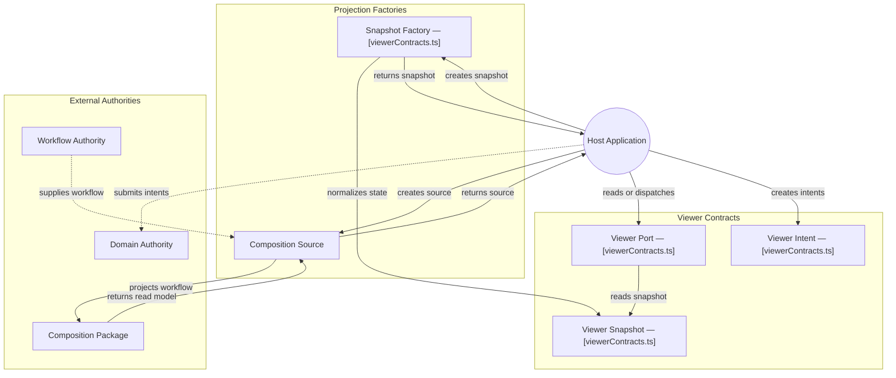

# GitDiagram architecture — @konitif/viewer

This architecture view was generated from the public repository by [GitDiagram](https://gitdiagram.com/lemouf/konitif-viewer) on 2026-09-20 19:02:20 UTC.

It is a documentation projection of the repository tree, README, and source files sampled by GitDiagram. It does not replace the authored contracts in [catalog.json](catalog.json) and [diagrams.json](diagrams.json), nor does it establish runtime authority.

The Mermaid source keeps GitDiagram's groups, nodes, relationships, and source links. GitDiagram's forced color classes and HTML line breaks are omitted so the diagram remains readable in local previews and dark themes.

- Public repository: [konitif-viewer](https://github.com/LeMouf/konitif-viewer)
- Interactive diagram: [Open in GitDiagram](https://gitdiagram.com/lemouf/konitif-viewer)

## Architecture diagram

## Generated analysis

@konitif/viewer is a small contract-and-adapter library. A host creates normalized viewer snapshots or a detached workflow-composition source, then exposes/uses a ViewerPort to read state and dispatch selection, focus, or reset intents. The host remains responsible for forwarding intents to domain authorities; rendering and camera behavior are explicitly outside this package. The composition dependency supplies workflow cloning and read-model projection. Arrows are limited to sampled implementation calls and README-documented authority boundaries.
